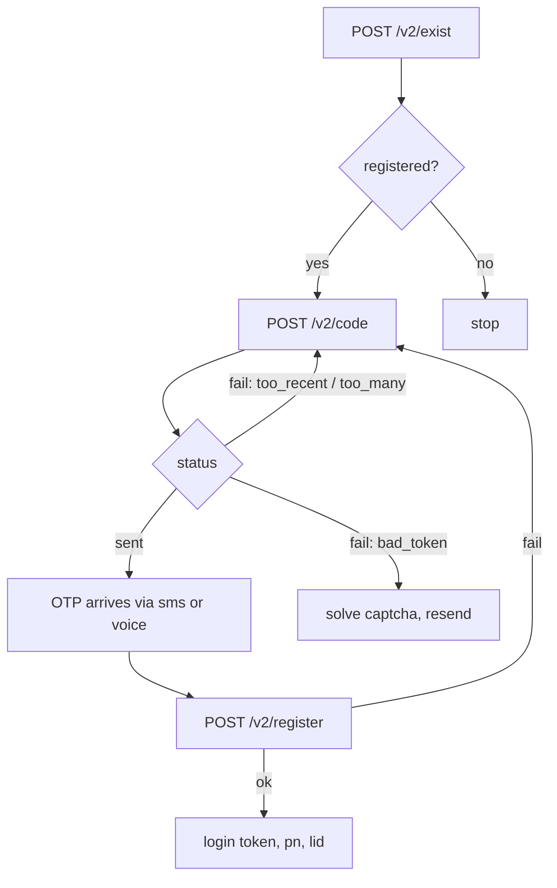

<div align="center">


# waghost

**Request and verify WhatsApp registration OTPs over raw HTTP.**
No app, no QR code, no browser.

[](https://pypi.org/project/waghost/)
[](https://pypi.org/project/waghost/)
[](LICENSE)
[](https://github.com/USER/waghost/actions/workflows/ci.yml)

</div>

---

`waghost` talks to the same `v.whatsapp.net` endpoints the official Android
client uses, so you can trigger a verification SMS, read it, and complete
registration entirely from a terminal. Useful for number farms, CI-driven
provisioning, temp-number services, and anyone who just wants to know whether
a number is on WhatsApp.

## Features

- **Headless registration** — request the code and verify it over plain HTTP.
- **Two delivery methods** — `sms` or `voice` call fallback.
- **Stable device identity** — persisted `id` + `authkey` so `/code` and
  `/register` stay in sync.
- **Auto-OTP harvesting** — pull the code off a USB-connected Android phone
  via ADB, no root required.
- **Number reconnaissance** — `/v2/exist` reports whether a number is
  registered and leaks handset model before any code is sent.
- **Machine-readable output** — `--json` for scripting.
- **Zero heavy dependencies** — one runtime dep (`requests`), stdlib ADB path.
- **Sane exit codes** — distinguish rate limits from bad tokens in a shell.

## Install

```bash
# Recommended: isolated CLI install
pipx install waghost

# Or into a virtualenv
python -m venv .venv && source .venv/bin/activate
pip install waghost

# Or from source, editable, with dev tools
git clone https://github.com/USER/waghost.git
cd waghost
python -m venv .venv && source .venv/bin/activate
pip install -e ".[dev]"
```

<details>
<summary>Termux</summary>

```bash
pkg update && pkg upgrade -y
pkg install python git -y
pip install waghost
```

</details>

<details>
<summary>Docker</summary>

```bash
docker build -t waghost .
docker run --rm waghost --cc 1 --phone 5551234567
```

</details>

Verify:

```bash
waghost --version
```

## Quick start

```bash
# 1. Is this number even on WhatsApp? (free, no code sent)
waghost --cc 1 --phone 5551234567 --check

# 2. Request the code
waghost --cc 1 --phone 5551234567

# 3. Verify it
waghost --cc 1 --phone 5551234567 --code 123456
```

One-shot with a voice call instead of SMS:

```bash
waghost --cc 1 --phone 5551234567 --method voice
```

Fully automatic, reading the OTP off a tethered phone:

```bash
waghost --cc 1 --phone 5551234567 --auto-otp --json
```

## CLI reference

| Flag | Default | Description |
|---|---|---|
| `--cc` | `1` | Country code, digits only, no `+` |
| `--phone` | *required* | Subscriber number, digits only |
| `--method` | `sms` | Delivery channel: `sms` or `voice` |
| `--code` | – | Skip requesting, verify this code directly |
| `--check` | – | Only run `/v2/exist` and exit |
| `--auto-otp` | – | Harvest the OTP from a tethered phone via ADB |
| `--otp-timeout` | `180` | Seconds to wait for an auto-harvested OTP |
| `--recaptcha` | – | reCAPTCHA token when the server demands one |
| `--state` | `./wa_state.json` | Path to the persisted device identity |
| `--reset` | – | Generate a fresh device identity first |
| `--json` | – | Emit raw JSON instead of human output |
| `--quiet` | – | Suppress non-essential logging |
| `--version` | – | Print version and exit |

## Library usage

```python
from waghost import load_state, request_code, register

state = load_state("wa_state.json")

res = request_code("1", "5551234567", state)
print(res["status"], res.get("retry_after"))

# ...user reads the SMS...

res = register("1", "5551234567", state, "123456")
print(res["login"])
```

Catch typed failures instead of parsing strings:

```python
from waghost import RateLimited, BadToken, WAError

try:
    request_code("1", "5551234567", state)
except RateLimited as e:
    time.sleep(e.retry_after)
except BadToken:
    print("solve the captcha and pass --recaptcha")
```

## How it works



Three stages, all plain `POST`s:

1. **`/v2/exist`** — confirms registration status and returns device metadata.
2. **`/v2/code`** — triggers the OTP. `method` selects SMS or voice call.
3. **`/v2/register`** — submits `code` and returns a `login` token.

The server keys the pending registration on the `id` (16-char uppercase hex
device id) and `authkey` (43-char base64) pair. These **must be byte-identical**
across stages 2 and 3, which is exactly what the state file guarantees. The
`authkey` doubles as the client's Noise static key at login, so it is worth
keeping around even after registration.

## Rate limits and failure modes

| `status` | `reason` | Meaning | Action |
|---|---|---|---|
| `sent` | – | Code dispatched | Read the SMS/voice call |
| `ok` | – | Registered | Store `login` |
| `fail` | `too_recent` | Asked too soon | Wait `retry_after` seconds |
| `fail` | `too_many` | Hourly cap hit | Wait, roughly an hour |
| `fail` | `bad_token` | Identity mismatch or captcha required | Reuse state, or pass `--recaptcha` |
| `fail` | `missing` | Malformed key-exchange blob | Regenerate state with `--reset` |

> `too_recent` and `too_many` reset on separate clocks from the voice-call
> path — switching `--method voice` after an SMS failure often gets you a
> fresh attempt immediately.

## Exit codes

| Code | Constant | Meaning |
|---|---|---|
| `0` | `EXIT_OK` | Success |
| `1` | `EXIT_FAIL` | Unspecified server failure |
| `2` | `EXIT_USAGE` | Bad arguments |
| `3` | `EXIT_RATE` | Rate limited |
| `4` | `EXIT_BADTOKEN` | Bad token / captcha required |
| `5` | `EXIT_TIMEOUT` | `--auto-otp` timed out |

## Troubleshooting

**`bad_token` on a fresh run**
Bump the `User-Agent` in `waghost/core.py` to a current WhatsApp release, or
delete the state file and start over with `--reset`.

**No SMS arrives**
Try `--method voice`. Carrier filtering and shortcode blocks are the usual
cause, not WhatsApp.

**`--auto-otp` finds nothing**
Confirm `adb devices` lists the handset. If the inbox query returns empty, the
shell user lacks `READ_SMS` on that ROM — use `adb logcat` instead, or run from
Termux with `termux-sms-list`.

**`too_many` immediately**
Another device or automation is already hammering the number. Check with
`--check` before requesting.

## Development

```bash
make dev     # editable install + dev deps
make test    # pytest
make lint    # ruff
make build   # sdist + wheel
```

## Disclaimer

`v.whatsapp.net` is unofficial and undocumented by Meta. The parameter set
drifts between app versions; pin your expectations accordingly. Not affiliated
with WhatsApp or Meta.

## License

[MIT](LICENSE) © 2026 Your Name